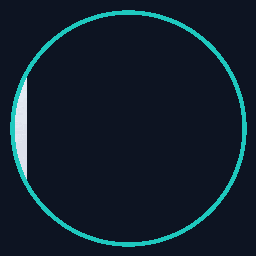

# Hey, I'm Divyank Singh

### Developer from India | Building thoughtful web experiences

## About Me

- I enjoy turning ideas into useful, polished web experiences.
- I work across frontend interfaces and full-stack JavaScript projects.
- I am continuously learning, experimenting, and improving through hands-on projects.

## Tech Stack

  
  
  
  
  
  
  
  
  

## Featured Projects

| Project | What it is |
| --- | --- |
| [Friend_GPT](https://github.com/divyank369/Friend_GPT) | Full-stack AI chat application with streamed responses and conversation history |
| [Wanderlust](https://github.com/divyank369/Wanderlust) | Travel-listing application with user accounts, listings, and reviews |
| [StockBroker-](https://github.com/divyank369/StockBroker-) | Stock dashboard project with a React frontend and Node.js API |
| [CrypytoTrackerApiMain](https://github.com/divyank369/CrypytoTrackerApiMain) | React app for cryptocurrency market data and coin charts |
| [CryptoPulse](https://github.com/divyank369/CryptoPulse) | Cryptocurrency dashboard interface |
| [College-Information-System](https://github.com/divyank369/College-Information-System) | Go command-line university records application |

## GitHub at a Glance

  
  

  

## Contributions

  
  

### Thanks for stopping by!

*Open to learning, building, and collaborating on interesting ideas.*

